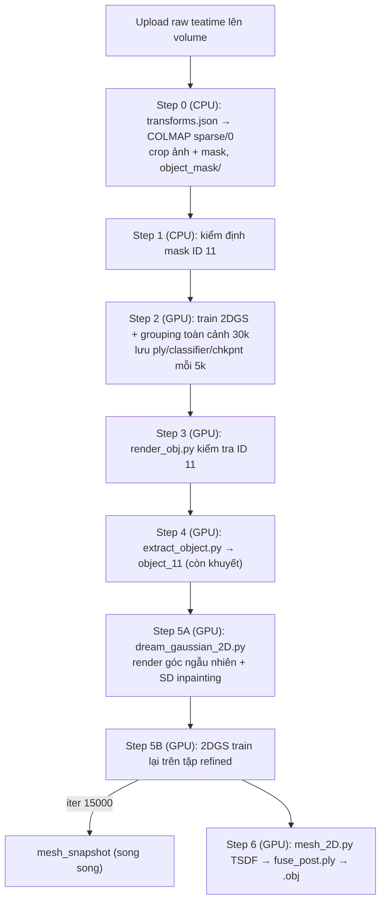

# Kế Hoạch Chạy OMEGAS Trên Modal GPU — Teatime, Vật Thể ID 11 (khăn giấy trắng)

Mục tiêu: chạy pipeline **OMEGAS** (2DGS + Gaussian Grouping → tách vật thể → bù phần khuất bằng Stable Diffusion → trích mesh TSDF) trên **Modal GPU** cho dataset **Teatime** (`F:\LERF Datasets\teatime\teatime`), vật thể **ID 11**.

- ID 11 trong `mask/labels/*.png` là **chiếc khăn giấy trắng** ở góc dưới bên phải bàn (thấy rõ nhất ở `frame_00140`; xuất hiện trong 106/180 frame; diện tích trung bình khoảng 1% ảnh; thường bị **cắt ở mép ảnh**).
- Tên kết quả theo quy ước của dự án: `outputs/teatime_napkin/stepN_*`. Khi chạy lại một bước đã xong thì tạo `_v2`, `_v3`, … và **không ghi đè**.

> Plan này đã được đối chiếu với code thật trong `F:\Safe-GS\Based_Model\OMEGAS`. Mọi lỗi tìm được ở plan cũ được liệt kê ở **Phụ lục A** kèm cách xử lý.
> Nguyên tắc: **không sửa code của tác giả**. Mọi thứ cần thêm (runner, chuyển dữ liệu, config, launcher) nằm trong thư mục mới `modal_omegas/`.

---

## 0. Môi Trường Local (venv trên ổ F, không cài gì lên ổ C)

Trên máy local chỉ cần **Modal CLI**. Việc build image (torch, CUDA, pytorch3d, diffusers, …) và tải model HuggingFace đều chạy **trên cloud của Modal**, nên không có thư viện nặng nào được tải về laptop.

Venv của dự án là `F:\Safe-GS\.venv` (Python 3.10, do `uv` tạo, **không có pip**). Hiện `modal 1.6.0` đang được cài ở `C:\Users\ACER\AppData\Roaming\Python\Python312` (ổ C). Từ giờ ta dùng bản cài trong venv.

### 0.1. Kích hoạt venv và đưa cache/temp sang ổ F (làm ở đầu **mỗi** phiên terminal)

PowerShell:
```powershell
cd F:\Safe-GS
# Nếu PowerShell chặn script: chỉ mở khóa cho phiên hiện tại
Set-ExecutionPolicy -Scope Process -ExecutionPolicy Bypass
.\.venv\Scripts\Activate.ps1          # dấu nhắc lệnh sẽ hiện (Safe-GS) / (.venv)

# Mọi cache/temp nằm trên ổ F
$env:UV_CACHE_DIR  = "F:\Safe-GS\.cache\uv"
$env:PIP_CACHE_DIR = "F:\Safe-GS\.cache\pip"
$env:TEMP = "F:\Safe-GS\tmp"; $env:TMP = "F:\Safe-GS\tmp"
$env:PYTHONUTF8 = "1"                 # log tiếng Việt / unicode không lỗi
```
- cmd.exe: `F:\Safe-GS\.venv\Scripts\activate.bat`
- Git Bash: `source /f/Safe-GS/.venv/Scripts/activate`

### 0.2. Cài Modal vào venv (chỉ làm một lần)
```powershell
uv pip install "modal==1.6.0"          # venv đang active nên uv cài vào .venv
python -c "import modal, sys; print(modal.__version__, modal.__file__)"   # đường dẫn phải là F:\Safe-GS\.venv\...
```

### 0.3. Kiểm tra workspace Modal
```powershell
python -m modal profile current        # phải là: nguyenkhacd10
python -m modal profile list
```
Luôn gọi `python -m modal ...` (không gọi `modal ...`) để chắc chắn dùng bản trong venv.

---

## 1. Cấu Trúc File & Thư Mục

### 1.1. File mới (code của tác giả giữ nguyên)
```text
F:\Safe-GS\Based_Model\OMEGAS\modal_omegas\
├── modal_omegas.py           # Modal app: image, volume, các step function, orchestrator run_all
├── prepare_teatime.py        # transforms.json (nerfstudio) -> COLMAP sparse/0 + crop ảnh/mask
├── check_masks.py            # Step 1: kiểm định mask ID 11, xuất report + preview
├── hf_launch.py              # Launcher: đổi repo HF đã bị xóa sang mirror, rồi runpy script tác giả
├── constraints.txt           # Ghim numpy/torch/diffusers… để pip không nâng cấp lung tung
├── teatime_obj11.json        # config Gaussian Grouping (num_classes, removal_thresh, select_obj_id)
└── dream_teatime_obj11.yaml  # config DreamGaussian cho vật thể 11 (đủ mọi key code cần)
```

### 1.2. Modal Volume `omegas` (workspace `nguyenkhacd10`) + Dict `omegas-ctl`
```text
/vol/
├── raw/teatime/                     # upload từ local: images/, mask/labels/, mask/objects.json, transforms.json
├── data/teatime/                    # Step 0 tạo: images/ (đã crop), object_mask/, sparse/0/
├── hf_cache/                        # HF_HOME: SD 2.1-base + SD inpainting (chỉ tải 1 lần)
└── outputs/teatime_napkin/
    ├── state/stepN.json             # trạng thái từng bước: running/done/failed, thời gian, lệnh, lỗi
    ├── step0_data/                  # report chuyển COLMAP (số ảnh đăng ký, số điểm 3D)
    ├── step1_sam_masks/             # mask_validation_report.json + preview ID 11
    ├── step2_2dgs_scene/            # model 2DGS toàn cảnh: point_cloud/iteration_*/(ply + classifier.pth), chkpnt*.pth
    ├── step3_id_check/              # render kiểm tra ID 11 (render_obj.py)
    ├── step4_object_extraction/     # model/object_11/point_cloud/iteration_30000/point_cloud.ply (còn khuyết)
    ├── step5_gaussian_completion/
    │   ├── object_11/refined/       # output DreamGaussian: images/, cameras.json, sd/, mask/ …
    │   └── refined_2dgs/            # 2DGS train lại trên tập refined (chkpnt + point_cloud định kỳ)
    └── step6_mesh_extraction/
        ├── intermediate/mesh_iter_15000/   # fuse.ply, fuse_post.ply, .obj
        └── final/mesh_iter_30000/          # fuse.ply, fuse_post.ply, object_11_mesh.obj
```
Tải về local: `F:\Safe-GS\Based_Model\OMEGAS\outputs\teatime_napkin\...` (xem mục 6).

---

## 2. Container Image (build trên Modal, không build ở local)

Chọn theo README của tác giả: **Python 3.9 + CUDA 11.8 + torch 2.0.1**.

```python
REPO = "/root/OMEGAS"
LOCAL_ROOT = Path(__file__).resolve().parents[1]          # F:\Safe-GS\Based_Model\OMEGAS
GPU = "L4"                                                  # mặc định L4 (tiết kiệm); A10G/A100 nếu cần nhanh
REPO_IGNORE = ["outputs", "outputs/**", "media", "media/**", "SuGaR/**",
               "Tracking-Anything-with-DEVA/**", "Grounded-Segment-Anything/**",
               "**/__pycache__/**", "**/*.pth", "**/*.ckpt", "plan.md"]

image = (
    modal.Image.from_registry("nvidia/cuda:11.8.0-cudnn8-devel-ubuntu22.04", add_python="3.9")
    .apt_install("git", "build-essential", "ninja-build", "wget", "ffmpeg",
                 "libgl1", "libglib2.0-0", "libsm6", "libxext6", "libgomp1", "colmap")
    .env({"TORCH_CUDA_ARCH_LIST": "8.6;8.9",     # A10G = 8.6, L4 = 8.9 (lúc build không có GPU)
          "FORCE_CUDA": "1", "PYTHONUNBUFFERED": "1",
          "QT_QPA_PLATFORM": "offscreen",         # cho colmap CLI headless
          "HF_HOME": "/vol/hf_cache"})
    .pip_install("torch==2.0.1", "torchvision==0.15.2", index_url="https://download.pytorch.org/whl/cu118")
    # Code tác giả phải được COPY vào image TRƯỚC khi pip install -r / build extension (lỗi A1)
    .add_local_dir(str(LOCAL_ROOT), REPO, copy=True, ignore=REPO_IGNORE)
    .run_commands(
        f"pip install -r {REPO}/requirements.txt -c {REPO}/modal_omegas/constraints.txt",
        # pytorch3d: wheel dựng sẵn cho py39/cu118/torch2.0.1; nếu 404 thì build từ source tag v0.7.5
        "pip install --no-index --no-cache-dir pytorch3d "
        "-f https://dl.fbaipublicfiles.com/pytorch3d/packaging/wheels/py39_cu118_pyt201/download.html "
        "|| pip install 'git+https://github.com/facebookresearch/pytorch3d.git@v0.7.5'",
        # diff-surfel-rasterization thiếu third_party/glm (lỗi A2) -> mượn glm của diff-gaussian-rasterization,
        # chỉ chép trong image, không động vào thư mục local
        f"cp -r {REPO}/gaussian_splatting/submodules/diff-gaussian-rasterization/third_party "
        f"{REPO}/gaussian_splatting/submodules/diff-surfel-rasterization/",
        f"pip install {REPO}/gaussian_splatting/submodules/diff-surfel-rasterization",
        f"pip install {REPO}/gaussian_splatting/submodules/simple-knn",
        # smoke test import ngay lúc build
        "python -c \"import torch, diff_surfel_rasterization, simple_knn, pytorch3d, open3d, diffusers, rembg; print('imports OK')\"",
    )
)
```

`modal_omegas/constraints.txt` (ghim để các gói không kéo numpy/torch lên bản mới):
```text
torch==2.0.1
torchvision==0.15.2
numpy==1.23.1
diffusers==0.25.1
transformers==4.36.2
huggingface_hub==0.20.3
accelerate==0.25.0
rembg==2.0.50
onnxruntime==1.16.3
```
> Nếu bước build báo xung đột phiên bản, chỉ được nới các dòng trong `constraints.txt` (không sửa `requirements.txt` của tác giả). Ghi lại phiên bản cuối cùng chạy được vào mục 7.

---

## 3. Hai Cơ Chế Vận Hành Trên Cloud

### 3.1. Chạy nền thật sự (detach): orchestrator phải chạy trên Modal

`modal run --detach` chỉ giữ cho **các function trên cloud** tiếp tục chạy. Nếu `local_entrypoint` gọi lần lượt `step1.remote()`, `step2.remote()`, … thì khi tắt laptop, **các bước sau sẽ không được gọi** (lỗi A10).
Vì vậy toàn bộ chuỗi bước nằm trong một function `run_all` (chỉ cần CPU, timeout 24h). Function này gọi từng step function GPU bằng `.remote()` **từ trong container**:

```python
@app.function(image=image, cpu=1, volumes=VOLUMES, timeout=24 * 3600)
def run_all(start: int = 0, stop: int = 6, force: str = ""):
    steps = [step0_prepare_data, step1_check_masks, step2_train_scene, step3_id_check,
             step4_extract_object, step5_completion, step6_mesh]
    for i in range(start, stop + 1):
        if not force_step(i, force) and state_done(i):
            print(f"[skip] step{i} already done"); continue
        steps[i].remote(force=force_step(i, force))     # lỗi ở bất kỳ bước nào sẽ dừng chuỗi
```

Lệnh chạy (máy local, venv đã active):
```powershell
cd F:\Safe-GS\Based_Model\OMEGAS
python -m modal run --detach modal_omegas/modal_omegas.py::run_all
# chạy lẻ 1 bước:   python -m modal run --detach modal_omegas/modal_omegas.py::step2_train_scene
# chạy từ bước 4:   python -m modal run --detach modal_omegas/modal_omegas.py::run_all --start 4
```
Khi CLI in ra `App ID: ap-…` là có thể tắt máy.
Theo dõi: `python -m modal app list`, `python -m modal app logs ap-…`, hoặc trang https://modal.com/apps.
Muốn dừng: `python -m modal app stop ap-…`.

### 3.2. Lưu định kỳ + phục hồi khi Modal ngắt container

| Cơ chế | Cách làm |
|---|---|
| **Commit volume định kỳ** | Mỗi step chạy trong `with CommitLoop():`. Một thread nền gọi `vol.commit()` mỗi **300 s**, thêm một lần khi nhận SIGTERM (preemption) và một lần khi bước kết thúc. Giống `Based_Model/Inpaint360GS/modal_inpaint360gs.py`. |
| **Lưu hạt 3DGS định kỳ** | `--save_iterations 5000 10000 15000 20000 25000 30000` → `point_cloud/iteration_N/point_cloud.ply` **và** `classifier.pth` (code tác giả tự lưu cùng chỗ). `--checkpoint_iterations` cùng các mốc → `chkpntN.pth`. Chỉ giữ 2 `chkpnt` mới nhất để tiết kiệm dung lượng. |
| **Tự chạy lại** | Mỗi step GPU có `retries=modal.Retries(max_retries=2, initial_delay=30)`. Bị preempt thì Modal tự chạy lại step đó. |
| **Phục hồi ở mức bước** | `state/stepN.json` = `done` thì bước được bỏ qua khi chạy lại `run_all`. Bước chưa xong được chạy lại trong thư mục sạch. |
| **Mesh dự phòng** | Trong Step 5B có một watcher: khi thấy `refined_2dgs/point_cloud/iteration_15000/` thì `mesh_snapshot.spawn(15000)` chạy trên container riêng → `step6_mesh_extraction/intermediate/mesh_iter_15000/`. Nếu bước sau bị hỏng vẫn còn mesh để dùng. |

> **Giới hạn quan trọng (lỗi A9): không resume giữa chừng một lần train.** Trong `run_gaussian_2D.py`, đoạn `gaussians.restore(...)` đã bị tác giả comment, còn `--load_checkpoint` lại được truyền vào `Scene()` như một *số iteration*. Truyền `chkpntN.pth` vào sẽ crash. Ngoài ra checkpoint cũng không chứa classifier.
> Vì vậy: khi bị ngắt giữa Step 2 hoặc 5B, bước đó sẽ **train lại từ 0** (Step 2 trên L4 ước tính khoảng 1–2 giờ). Các file `chkpnt*.pth` và `point_cloud/iteration_*` vẫn được lưu để kiểm tra và làm mesh dự phòng.
> Nếu sau này cần resume thật sự, cách đúng theo quy ước dự án là copy OMEGAS sang `F:\Safe-GS\test_model\OMEGAS\src\` rồi bỏ comment đoạn `restore` ở đó (Based_Model giữ nguyên).

---

## 4. Quy Trình Từng Bước



Biến dùng chung: `D=/vol/data/teatime`, `O=/vol/outputs/teatime_napkin`, `cd /root/OMEGAS`.

### Bước chuẩn bị: upload dataset (local, chạy 1 lần)
Chỉ upload những gì cần (bỏ `images_2/4/8`):
```powershell
python -m modal volume create omegas
python -m modal volume put omegas "F:\LERF Datasets\teatime\teatime\images"           /raw/teatime/images
python -m modal volume put omegas "F:\LERF Datasets\teatime\teatime\mask\labels"      /raw/teatime/mask/labels
python -m modal volume put omegas "F:\LERF Datasets\teatime\teatime\mask\objects.json" /raw/teatime/mask/objects.json
python -m modal volume put omegas "F:\LERF Datasets\teatime\teatime\transforms.json"   /raw/teatime/transforms.json
python -m modal volume ls omegas /raw/teatime/images | Measure-Object -Line     # phải là 180 dòng
```

### Step 0 — Chuyển dữ liệu sang dạng OMEGAS đọc được (CPU, `cpu=8`, timeout 3h)
Lý do: loader `scene_2D` chỉ nhận `sparse/` (COLMAP), `cameras.json` hoặc `transforms_train.json`. Teatime chỉ có `transforms.json` (lỗi A6). Ngoài ra loader COLMAP chỉ nhận camera **PINHOLE**, và rasterizer bỏ qua cx/cy.

`prepare_teatime.py` làm theo logic đã chạy được trong `F:\Safe-GS\modal_lerf_prep.py::lerf_colmap`:
1. Với mỗi frame: tính crop box để principal point về đúng tâm ảnh, rồi **crop cùng một box** cho `images/frame_XXXXX.jpg` → `D/images/frame_XXXXX.png` và cho `mask/labels/frame_XXXXX.png` → `D/object_mask/frame_XXXXX.png`. Crop thuần, không resize, nên ID trong mask được giữ nguyên.
2. `colmap feature_extractor` (PINHOLE, CPU) + `exhaustive_matcher`.
3. Ghi `cameras.txt`/`images.txt` từ pose có sẵn (c2w nerfstudio → đổi trục `c2w[:3,1:3] *= -1` → w2c → qvec), rồi `colmap point_triangulator` → `sparse/0/points3D.bin`. Không chạy lại SfM.
4. Kiểm tra: 180 ảnh trong `images.txt`, số điểm 3D > 10k, mọi `object_mask/*.png` khớp kích thước với ảnh tương ứng. Ghi `O/step0_data/report.json`.

### Step 1 — Kiểm định mask ID 11 (CPU)
`python modal_omegas/check_masks.py --mask_dir $D/object_mask --id 11 --out $O/step1_sam_masks`
- Thống kê: số frame có ID 11, diện tích theo từng frame, số frame mà mask chạm mép ảnh. Xuất ảnh preview (overlay) cho `frame_00001`, `frame_00108`, `frame_00140` và ảnh lưới 12 frame.
- Tiêu chuẩn đạt: ID 11 có trong ≥ 80 frame và không có frame nào có mask vỡ thành nhiều mảnh lớn. Ghi `mask_validation_report.json`.
- **Không có nhánh chạy lại SAM/DEVA tự động**: `script/prepare_pseudo_label.sh` của tác giả gọi `train.py` không tồn tại. Mask LERF hiện có đã được SAM2 lan truyền với ID nhất quán. Nếu report không đạt thì dừng lại và báo cho người dùng.

### Step 2 — Train 2DGS + Gaussian Grouping toàn cảnh (GPU L4, timeout 8h, retries 2)
```bash
python run_gaussian_2D.py -s $D -m $O/step2_2dgs_scene \
  --config_file configs/gaussian_dataset/train.json --depth_ratio 1.0 --iterations 30000 \
  --save_iterations 5000 10000 15000 20000 25000 30000 \
  --checkpoint_iterations 5000 10000 15000 20000 25000 30000
```
- **Không** truyền `--load_checkpoint` (xem 3.2). Object loss mặc định **bật** (`--no_obj_loss` là `store_false`, chỉ dùng ở Step 5B).
- Xong khi có `point_cloud/iteration_30000/point_cloud.ply` + `classifier.pth` + `cameras.json` + `cfg_args`.

### Step 3 — Kiểm tra ID 11 (GPU)
`render_obj.py` ghi `renders/`, `images/`, `objects_pred/` thẳng vào `-m`. Để không làm bẩn Step 2, ta copy model sang thư mục riêng:
```bash
mkdir -p $O/step3_id_check/model/point_cloud
cp $O/step2_2dgs_scene/{cfg_args,cameras.json} $O/step3_id_check/model/
cp -r $O/step2_2dgs_scene/point_cloud/iteration_30000 $O/step3_id_check/model/point_cloud/
python render_obj.py -m $O/step3_id_check/model -s $D --iteration 30000 \
  --config_file modal_omegas/teatime_obj11.json
```
`teatime_obj11.json`: `{"num_classes": 256, "removal_thresh": 0.95, "select_obj_id": [11]}`
Kiểm tra: IoU giữa `objects_pred` và `object_mask==11` trên các frame có ID 11 (ghi vào `iou_report.json`). Trung bình IoU < 0.5 thì dừng và báo lại.

### Step 4 — Tách Gaussian của vật thể 11 (GPU)
`extract_object.py` ghi vào `<-m>/object_11/`, nên cũng dùng bản copy riêng:
```bash
mkdir -p $O/step4_object_extraction/model/point_cloud
cp $O/step2_2dgs_scene/{cfg_args,cameras.json} $O/step4_object_extraction/model/
cp -r $O/step2_2dgs_scene/point_cloud/iteration_30000 $O/step4_object_extraction/model/point_cloud/
python extract_object.py -m $O/step4_object_extraction/model -s $D --iteration 30000 \
  --config_file modal_omegas/teatime_obj11.json
```
Kết quả: `model/object_11/point_cloud/iteration_30000/point_cloud.ply` cùng các thư mục `renders/`, `images/`, `objects_pred/`.
Sau đó chuẩn bị đủ file mà DreamGaussian cần (lỗi A12). `extract_object.py` chỉ lưu `.ply`:
```bash
cp $O/step2_2dgs_scene/cameras.json $O/step4_object_extraction/model/object_11/
cp $O/step2_2dgs_scene/point_cloud/iteration_30000/classifier.pth \
   $O/step4_object_extraction/model/object_11/point_cloud/iteration_30000/
```
Kiểm tra: số Gaussian của vật thể nằm trong khoảng 1k–500k và bounding box nằm trong vùng khăn giấy.

### Step 5 — Bù phần khuất (GPU)
**5A. DreamGaussian (render góc ngẫu nhiên + SD inpainting).** Copy `object_11` sang `step5_gaussian_completion/object_11`, rồi:
```bash
python modal_omegas/hf_launch.py dream_gaussian_2D.py --config modal_omegas/dream_teatime_obj11.yaml
```
`dream_teatime_obj11.yaml` = bản sao của `configs/dream/dream_teatime.yaml`, thay/thêm các key mà code đọc nhưng yaml gốc không có (lỗi A12):
```yaml
prompt: "a photo of a white paper napkin"
load: /vol/outputs/teatime_napkin/step5_gaussian_completion/object_11/
iteration: "30000"       # PHẢI là chuỗi: code ghép "iteration_" + opt.iteration
select_obj_id: [11]
depth_ratio: 1.0
render_mesh: false       # true thì cần mesh_2D chạy trên object trước (train/ours_30000/fuse_post.ply)
sd: ""                   # "" -> dùng SD 2.1-base gốc (không phải dreambooth 'refined_sd')
threshold: 17            # mặc định của sd_mask()
random_n: 80
min_ver: -40
max_ver: -10             # khăn giấy nằm phẳng trên bàn: nhìn từ trên xuống
```
`hf_launch.py`: đặt `HF_HOME=/vol/hf_cache`, monkeypatch `from_pretrained` của diffusers và transformers để đổi repo id, rồi `runpy.run_path(script)`. Lý do: code tác giả hard-code các repo sau:
- `runwayml/stable-diffusion-inpainting` — **repo đã bị xóa khỏi HF** → đổi sang `stable-diffusion-v1-5/stable-diffusion-inpainting`.
- `stabilityai/stable-diffusion-2-1-base` — preflight sẽ kiểm tra; nếu 404/gated thì đổi sang một mirror (ghi vào mục 7).

Preflight chạy ở đầu Step 5A, tải trước các model vào `/vol/hf_cache` và commit. Nếu không tải được thì dừng ngay, không tốn GPU.

Kiểm tra sau 5A: `object_11/refined/cameras.json` có (số view gốc + 80) camera, và mỗi `img_name` có file `refined/images/<img_name>.jpg` tương ứng.

**5B. Train lại 2DGS trên tập refined** (timeout 6h, retries 2; watcher mesh 15k ở mục 3.2):
```bash
python run_gaussian_2D.py -s $O/step5_gaussian_completion/object_11/refined \
  -m $O/step5_gaussian_completion/refined_2dgs \
  --no_obj_loss --depth_ratio 1.0 --lambda_dist 1000 --iterations 30000 \
  --save_iterations 5000 10000 15000 20000 25000 30000 \
  --checkpoint_iterations 5000 10000 15000 20000 25000 30000
```
(30000 iteration theo README của tác giả. Tập refined không có `points3D.ply` nên code tự khởi tạo điểm ngẫu nhiên, giống README.)

### Step 6 — Trích mesh (GPU)
`mesh_2D.py` ghi vào `<-m>/train/ours_N/`, nên mỗi mốc dùng một bản copy model trong `step6_mesh_extraction/`:
```bash
# N = 15000 (intermediate, do watcher spawn) và 30000 (final)
python mesh_2D.py -s $O/step5_gaussian_completion/object_11/refined \
  -m $O/step6_mesh_extraction/<intermediate|final>/mesh_iter_N/model --iteration N \
  --depth_ratio 1.0 --voxel_size 0.004 --sdf_trunc 0.016 --depth_trunc 3.0 --skip_test
```
- Output gốc: `train/ours_N/fuse.ply` và `fuse_post.ply` (mesh TSDF **có màu theo đỉnh**, không có texture.png hay .mtl).
- Runner dùng open3d chuyển `fuse_post.ply` → `object_11_mesh.obj`, ghi số đỉnh/mặt, rồi tạo `manifest.json` (sha256 của từng file) để kiểm tra sau khi tải về.
- Mesh rỗng hoặc < 1000 mặt thì chạy lại với `--voxel_size 0.008 --sdf_trunc 0.032` vào thư mục `_v2` (không ghi đè).

---

## 5. Chi Phí & Thời Gian Ước Tính (L4)

| Bước | Tài nguyên | Ước tính |
|---|---|---|
| Build image (lần đầu) | CPU | 20–40 phút (pytorch3d nếu phải build từ source) |
| Step 0 COLMAP | 8 CPU | 20–40 phút |
| Step 2 train 30k | L4 | 1–2 giờ |
| Step 3 + 4 | L4 | 10–20 phút |
| Step 5A (tải SD lần đầu + inpaint 80 view) | L4 | 20–40 phút |
| Step 5B train 30k | L4 | 30–60 phút |
| Step 6 mesh ×2 | L4 | 10–20 phút |

**Chỉ bắt đầu chạy GPU khi người dùng đồng ý.** Nên chạy thử `run_all --stop 1` (chỉ CPU) trước để kiểm tra image và dữ liệu.

---

## 6. Tải Kết Quả Về Local & Kiểm Tra

```powershell
cd F:\Safe-GS\Based_Model\OMEGAS
python -m modal volume get omegas /outputs/teatime_napkin/step6_mesh_extraction outputs\teatime_napkin\
python -m modal volume get omegas /outputs/teatime_napkin/step1_sam_masks       outputs\teatime_napkin\
# Kiểm tra toàn vẹn: so sha256 với manifest.json (file tải về có thể hỏng dù dung lượng vẫn đúng)
python modal_omegas/modal_omegas.py --verify outputs\teatime_napkin\step6_mesh_extraction
```
- Thư mục local đã tồn tại thì tải vào `..._v2` (không ghi đè).
- Không tải `step2_2dgs_scene` (vài GB) trừ khi cần.

---

## 6b. Thay Đổi Khi Triển Khai Code (2026-11-02) — ưu tiên hơn các mục trên

Code nằm trong `modal_omegas/` (đã viết xong):

| File | Vai trò |
|---|---|
| `modal_omegas.py` | Modal app `omegas-teatime-napkin`, volume `omegas`, step0…step6, `run_all`, các lệnh local `upload` / `start` / `status` / `download` / `verify` |
| `prepare_teatime.py` | Step 0 (COLMAP + crop + xoay trục) |
| `check_masks.py` | Step 1 |
| `object_tools.py` | IoU Step 3, thống kê ply, tham số TSDF, chuyển .obj, manifest sha256 |
| `omegas_launch.py` | (thay cho `hf_launch.py`) launcher cho Step 5: các bản vá chỉ áp dụng trong bộ nhớ |
| `gs_renderer_2D.py` | **Tự viết lại**: file này bị thiếu trong code tác giả |
| `teatime_obj11.json`, `dream_teatime_obj11.yaml`, `constraints.txt` | config |

Những điểm khác so với plan ở trên:
1. **Python 3.10** thay cho 3.9: Modal 1.6 không còn hỗ trợ image Python 3.9. torch 2.0.1+cu118, pytorch3d 0.7.4 (wheel `py310_cu118_pyt201`), numpy 1.23.1 đều có bản cho 3.10.
   - Code repo được *mount* lúc chạy, không copy vào image. Chỉ `diff-surfel-rasterization` (kèm thư mục glm mượn từ diff-gaussian-rasterization) và `simple-knn` được copy vào `/opt/ext` để build.
   - `paddleseg` bị bỏ khỏi `requirements.txt` khi cài vì OMEGAS không import nó.
2. **Step 0 crop chung một kích thước 978×686** cho cả 180 frame. LERF có intrinsics riêng từng frame; nếu crop riêng thì ra 57 kích thước khác nhau. Principal point sau khi crop lệch tâm ≤ 0,5 px.
   - Scene được **xoay để hướng "lên" = −y**, giống COLMAP. Đã kiểm tra ở local: R là phép quay đúng (det = +1), camera nằm phía trên bàn và nhìn xuống.
3. **Code tác giả thiếu `dreamgaussian/gs_renderer_2D.py`**. Repo gốc đã bị xóa (404), bản mirror alexippoliti/OMEGAS cũng không có. Ngoài ra `dream_gaussian_2D.py` không tương thích với `cam_utils.py` của chính repo:
   - `OrbitCamera` không nhận `fovx`, và đọc fovy theo độ trong khi yaml ghi radian.
   - `save_camera` trả về vị trí camera thiếu target.
   - Dòng 3 hard-code `CUDA_VISIBLE_DEVICES="3"`.

   `omegas_launch.py` xử lý tất cả mà không sửa file của tác giả. Repo HF `stabilityai/stable-diffusion-2-1-base` trả về 401 → đổi sang `sd2-community/stable-diffusion-2-1-base`; `runwayml/stable-diffusion-inpainting` → `stable-diffusion-v1-5/stable-diffusion-inpainting`.
4. **Step 5A tạo ra những gì:** `refined/images` chỉ chứa 80 ảnh `random_*.jpg`. Runner chép thêm các view gốc (`object_11/images/*.jpg` từ Step 4) vào đó, và ghi `refined/points3D.ply` từ các Gaussian của vật thể. Nếu không có file này, loader sẽ khởi tạo điểm ngẫu nhiên trong khối [-1.3, 1.3]³.
   - W, H, fovx, fovy được lấy từ `cameras.json`. `radius` được chọn sao cho khoảng cách orbit bằng trung vị khoảng cách từ các camera thật tới vật thể.
   - Góc nhìn `min_ver`/`max_ver` = 10…45 (nhìn từ trên xuống, theo trục đã xoay ở Step 0).
5. **Mesh (Step 6)** có tham số `source=step4` (bản v1, không bù) hoặc `source=step5` (v2). TSDF tự tính theo kích thước vật thể: voxel = extent/320, sdf_trunc = 4·voxel, depth_trunc = khoảng cách camera xa nhất + extent. Mesh snapshot 15k của bản v2 được chạy song song ngay trong container Step 5B, ghi vào `step5_*/mesh_snapshot_15000/`.
5b. **Step 5 cài đặt bám theo paper** (2404.15891v4, mục *Target Replenishment* + *Implementation Details*):

| Paper | Code tác giả | Cách làm ở đây |
|---|---|---|
| Personalize SD 2.1 bằng DreamBooth trên ảnh vật thể tách từ view gốc (Eq. 8) | Chỉ có đoạn *load* `dreamgaussian/dreambooth/{hf_key}_finetuned/{unet,text_encoder}` (thiếu `f`, nên đường dẫn giữ nguyên dấu ngoặc). **Không có script train** | **5P** `tr_dreambooth.py`: DreamBooth UNet + text encoder, prior preservation (100 ảnh "a photo of napkin"), 600 bước, lr 2e-6, chạy trên A100-40GB. Ảnh instance = 20 crop 512² từ `object_11/images` của Step 4. Prompt "a photo of sks napkin". `omegas_launch.py` trỏ đường dẫn trên sang weights này; yaml đặt `sd: "refined_sd"` |
| Render n view mới của target | `random_render_mask`: `random_n=80` | giữ nguyên (80 view) |
| Mask: z0 = E(x0), t = 991, Δε = ε_θ*(z_t, "", t) − ε, m = B∘D(Δε), **10 seed** | `sd_mask`: giống paper nhưng chỉ **5 seed** | `sd_mask` vá trong bộ nhớ thành **10 seed** (`OMEGAS_MASK_SEEDS`), phần còn lại giữ nguyên |
| Inpaint bằng **stable-diffusion-2-inpainting** (footnote 1) | `runwayml/stable-diffusion-inpainting` (SD-1.5) | dùng SD-2-inpainting (mirror `sd2-community/stable-diffusion-2-inpainting`, vì bản stabilityai trả về 401) |
| Đưa ảnh đã inpaint vào train tiếp mô hình target | README: `run_gaussian_2D.py -s refined …` (train lại từ đầu, điểm khởi tạo ngẫu nhiên) | **5B** như README, nhưng khởi tạo từ `points3D.ply` lấy từ chính các Gaussian của target. Trong code tác giả, nếu load ply thì `spatial_lr_scale` = 0, tức vị trí điểm bị đóng băng, nên không đi đường đó |

   Mask SD còn được nhân với vùng target do classifier dự đoán (bị erode); đây là chi tiết của code tác giả, giữ nguyên.

6. **Theo yêu cầu người dùng: lần chạy đầu chỉ làm Step 0→4 rồi dừng** (`start` mặc định `--steps 0,1,2,3,4`). Step 5 sẽ chạy sau khi người dùng xem lại.

Lệnh (venv đã active, `cd F:\Safe-GS\Based_Model\OMEGAS`):
```powershell
python -m modal run modal_omegas/modal_omegas.py::upload
python -m modal run --detach modal_omegas/modal_omegas.py::start                      # Step 0-4
python -m modal run modal_omegas/modal_omegas.py::status
python -m modal run --detach modal_omegas/modal_omegas.py::start --steps 5,6 --mesh-source step5   # sau khi duyệt Step 5
python -m modal run --detach modal_omegas/modal_omegas.py::start --steps 6                          # mesh v1 từ Step 4
python -m modal run modal_omegas/modal_omegas.py::download --step 4
```

---

## 7. Nhật Ký Chạy (cập nhật khi thực thi)

| Ngày | Bước | App ID | Kết quả / ghi chú |
|---|---|---|---|
| 2026-11-02 | build + upload | ap-et2XpdnWeA5MLaKn3PDs77 | Build tới lần thứ 4 mới xong (đổi sang `extra_index_url`, thêm fvcore/iopath cho pytorch3d, đặt `CC=gcc`/`CXX=g++`). Upload 180 ảnh + 180 mask |
| 2026-11-02 | Step 0 → `step0_data_v2` | ap-BURp…, ap-myIw… | 180/180 ảnh đăng ký, 24.590 điểm 3D, reproj 0,77 px, crop 978×686. Bản v2 ghi mask **3 kênh** (run_gaussian_2D đọc `gt_obj[:, :, 0]`) |
| 2026-11-02 | Step 1 → `step1_sam_masks_v2` | | đạt: ID 11 có trong 101 frame, mask liền khối ở 99% số frame, 19 frame chạm mép ảnh |
| 2026-11-02 | Step 2 → `step2_2dgs_scene` | | 30k iteration trong 69 phút (A10G), loss 0,09, Obj 0,05, khoảng 634k Gaussian |
| 2026-11-02 | Step 3 → `step3_id_check` | | IoU ID 11 trung bình 0,664, trung vị 0,709 (frame 140: 0,94). `render_obj.py` cần mask **1 kênh**, nên dùng bản `data/teatime_1ch`; màu theo `render.py::id2rgb` (golden 1.618) |
| 2026-11-02 | Step 4 → `step4_object_extraction` | ap-… (run 9) | Khăn giấy còn 3.189 Gaussian; `object_11/images` tách gọn khăn giấy. **Dừng ở đây theo yêu cầu, chờ duyệt Step 5** |

Các lỗi trong code tác giả gặp khi chạy và cách xử lý (không sửa file gốc):
- `render_obj.py`, `extract_object.py`, `mesh_2D.py`, `dream_gaussian_2D.py` hard-code `CUDA_VISIBLE_DEVICES` → chạy qua `omegas_launch.py` (khởi tạo CUDA trước).
- `render.py` cần `diff_gaussian_rasterization`; `mesh_utils.py` cần `pyrender` (không có trong requirements) → thêm vào image.
- Hai script đòi định dạng mask khác nhau (3 kênh và 1 kênh) → dùng hai bản dữ liệu.

Phiên bản thư viện / mirror HF cuối cùng chạy được: _(điền sau khi build)_

---

## Phụ lục A — Các lỗi của plan cũ và cách xử lý

| # | Lỗi trong plan cũ | Bằng chứng trong code | Xử lý trong plan này |
|---|---|---|---|
| A1 | Image `pip install -r /root/OMEGAS/...` nhưng không copy code vào image | không có `add_local_dir` | `add_local_dir(..., copy=True)` trước `run_commands` |
| A2 | `diff-surfel-rasterization` thiếu `third_party/glm` | `setup.py:30` include `third_party/glm/` | chép glm từ `diff-gaussian-rasterization` trong image |
| A3 | Không đặt `TORCH_CUDA_ARCH_LIST` khi build extension | build không có GPU | `TORCH_CUDA_ARCH_LIST=8.6;8.9` |
| A4 | Thiếu `pytorch3d`, `libgl1`/`libgomp1`; diffusers/transformers không ghim version | `general_utils.py`, `dream_gaussian_2D.py:20` import pytorch3d | wheel pytorch3d + apt + `constraints.txt` |
| A5 | Không có bước upload dataset | — | mục "Bước chuẩn bị" |
| A6 | Teatime chỉ có `transforms.json`; loader cần `sparse/` (PINHOLE) | `scene_2D/__init__.py:49-57`, `dataset_readers.py` assert PINHOLE | Step 0 chuyển sang COLMAP + crop principal point |
| A7 | Mask chưa nằm ở `object_mask/` | loader đọc `object_mask/<name>.png` | Step 0 crop + copy `mask/labels` |
| A8 | `script/eval_mask.py` không tồn tại | — | `modal_omegas/check_masks.py` |
| A9 | Auto-resume bằng `--load_checkpoint` sẽ crash | `run_gaussian_2D.py:116` truyền vào `Scene(load_iteration=…)`; `restore` bị comment (128-130) | Bỏ resume giữa chừng; retry ở mức bước + commit định kỳ |
| A10 | `local_entrypoint` gọi lần lượt các bước → tắt máy là dừng chuỗi; chỉ commit khi bước kết thúc; timeout 4h cho cả pipeline | — | orchestrator `run_all` trên Modal; `CommitLoop` 300 s; mỗi bước một function, có timeout và retries riêng |
| A11 | Sai đường dẫn: `extract_object.py` ghi vào `<-m>/object_11`, không vào `step4_*` | `extract_object.py:241` | dùng bản copy model trong từng thư mục step |
| A12 | `dream_teatime_obj11.yaml` chưa có; thiếu key `iteration`(str)/`render_mesh`/`depth_ratio`/`sd`/`select_obj_id`/`threshold`; object dir thiếu `cameras.json` + `classifier.pth` | `dream_gaussian_2D.py:163,172,192,493,533,549,736` | yaml đầy đủ + copy 2 file ở cuối Step 4 |
| A13 | SD inpainting `runwayml/...` đã bị xóa khỏi HF; mỗi lần chạy đều tải lại model | `sd_utils.py:64` | `hf_launch.py` đổi sang mirror + `HF_HOME` trên volume |
| A14 | Step 6 ghi vào step5, không có `.obj`/texture; iteration không thống nhất (5000/10000/30000); mesh 15k ở Step 2 không được cài đặt | `mesh_2D.py:57,82` | copy model vào step6, chuyển .obj bằng open3d, mốc 15000/30000, watcher spawn snapshot |
| A15 | Lệnh local `modal run` có thể dùng Modal ở ổ C | `modal` đang nằm ở `AppData\Roaming\Python\Python312` | Mục 0: venv `F:\Safe-GS\.venv` + cache/temp trên ổ F |
