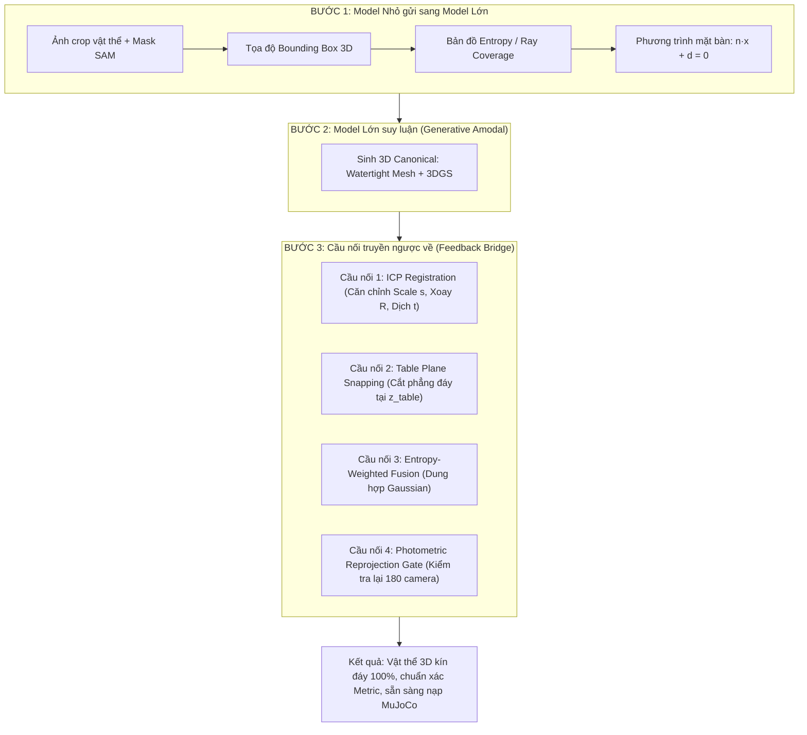
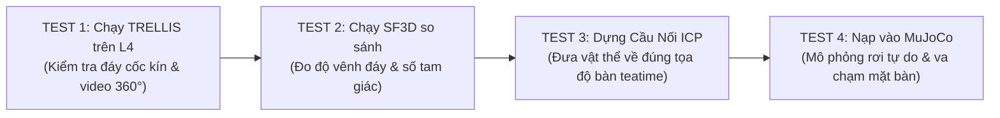

# SAFE-GS: MASS RESEARCH 3D FOUNDATION MODELS (2024 - 2026)
## Phân Tích Toàn Cảnh Các Mô Hình Sinh 3D, Amodal Completion & Cầu Nối "Model Lớn $\leftrightarrow$ Model Nhỏ"

> **Tài liệu nghiên cứu kỹ thuật chuyên sâu cho dự án Safe-GS**  
> **Mục tiêu**: Tái tạo vật thể 3D kín hoàn toàn (Watertight Mesh & 3DGS), hoàn thiện các góc khuất/đáy tiếp xúc mặt bàn (Amodal 360° Completion), phục vụ mô phỏng vật lý trong MuJoCo trên nền tảng GPU NVIDIA L4 (24GB VRAM).

---

## 1. VẤN ĐỀ CỐT LÕI: TẠI SAO CẦN CẦU NỐI "MODEL LỚN $\leftrightarrow$ MODEL NHỎ"?

### 1.1. Nghịch lý nếu chỉ dùng "Model Nhỏ" (Entropy / Ray-Casting / CoMe Confidence)
* **Model nhỏ là gì?** Là các bộ thống kê cục bộ từ dữ liệu quan sát:
  - Bản đồ mật độ tia ray-cast (Ray Coverage Map).
  - Điểm COLMAP SfM track length (số lượng camera nhìn thấy điểm đó).
  - Độ biến thiên màu sắc/pháp tuyến của Gaussian Splatting (CoMe confidence $\sigma$).
  - Entropy thông tin trên bản đồ phân đoạn (Segmentation cross-entropy).
* **Điểm yếu chí mạng**: Model nhỏ chỉ có chức năng **chẩn đoán** ("Chỗ này bị khuất, góc nhìn bằng 0, entropy = max"). Nó **hoàn toàn mù tịt về mặt tạo sinh** (Generative Prior). Nó không thể tự bịa ra được đáy cốc phẳng hay cong, độ dày thành bát là bao nhiêu, hay hoa văn mặt sau trông như thế nào.

### 1.2. Nghịch lý nếu chỉ dùng "Model Lớn" (TRELLIS, Hunyuan3D, SF3D, v.v.)
* **Model lớn là gì?** Là các mạng Foundation Image-to-3D / Multi-view Diffusion được huấn luyện trên hàng triệu vật thể 3D (Objaverse, ShapeNet).
* **Điểm yếu chí mạng khi chạy đơn độc**:
  - **Mất hệ quy chiếu thực (Coordinate Blindness)**: Model lớn luôn sinh vật thể trong một bounding box chuẩn hóa $[-1, 1]^3$ lơ lửng giữa chân không.
  - **Không biết mặt bàn thực (Plane Agnostic)**: Nó không hề biết mặt bàn trong scene `teatime` nghiêng góc nào, cao độ $z$ bao nhiêu. Đáy cốc nó sinh ra có thể bị lồi hoặc xéo, khi thả vào MuJoCo sẽ lập tức bị nảy (collision jitter) hoặc lơ lửng.
  - **Nguy cơ Hallucination sai lệch quan sát thực**: Nếu không có cơ chế ràng buộc, hình dạng nó tưởng tượng ra có thể mâu thuẫn với 180 góc ảnh camera đã chụp được.

```
       [ MODEL NHỎ: Quan sát thực ]                [ MODEL LỚN: Tri thức tạo sinh ]
       (Ray-cast, SfM, CoMe Confidence)             (TRELLIS, Hunyuan3D, SF3D, DiT)
                      │                                            │
           Biết: "Chỗ này bị khuất!"                      Biết: "Đáy cốc thường phẳng,
           Mù:   "Phải điền thế nào?"                            thành cốc hình trụ!"
                      │                                   Mù:   "Tọa độ thế giới ở đâu?
                      │                                          Bàn nằm ở z nào?"
                      └─────────────────────┬──────────────────────┘
                                            │
                                  [ CẦU NỐI 2 CHIỀU ]
                              (Bidirectional Feedback)
```

---

### 1.3. Cơ chế 4 Cầu Nối (Feedback Loop) để Model Lớn truyền về Model Nhỏ

Để đảm bảo độ tin cậy toán học và tính khả thi trong vật lý, hai model phải trao đổi thông tin qua 4 cầu nối:



#### Chi tiết toán học của 4 Cầu Nối:

1. **Cầu nối 1: Căn chỉnh Tọa độ & Metric Scale (Rigid Registration)**
   - Model lớn xuất ra đám mây điểm mặt nhìn thấy $\mathcal{P}_{gen}^{vis}$.
   - Model nhỏ có đám mây điểm SfM/Raycast quan sát được trong thế giới thực $\mathcal{P}_{real}^{vis}$.
   - Tìm phép biến đổi đồng dạng Sim(3) gồm tỉ lệ $s$, ma trận xoay $R \in SO(3)$, và vector tịnh tiến $t \in \mathbb{R}^3$:
     $$\min_{s, R, t} \sum_{i} \left\| \mathcal{P}_{real, i}^{vis} - (s R \cdot \mathcal{P}_{gen, i}^{vis} + t) \right\|^2$$
   - Khi đã có $(s, R, t)$, toàn bộ phần đáy khuất do model lớn sinh ra được map chính xác vào tọa độ scene thực của COLMAP.

2. **Cầu nối 2: Khóa hình học mặt phẳng đáy (Table Plane Snapping)**
   - Model nhỏ xác định được phương trình mặt bàn từ RANSAC mặt phẳng: $\Pi: \vec{n} \cdot \vec{x} + d = 0$ (hay $z = z_{table}$).
   - Tất cả các đỉnh (vertices) và Gaussian ở phần đáy do model lớn sinh ra được chiếu thẳng và ép phẳng tiếp xúc mặt $\Pi$:
     $$z_{bottom} \ge z_{table}, \quad \text{ép pháp tuyến đáy } \vec{n}_{bottom} = -\vec{n}_{table}$$
   - **Tác dụng**: Triệt tiêu 100% hiện tượng "đáy cốc gồ ghề" hoặc "đáy đĩa xiêu vẹo", đảm bảo vật thể đặt lên bàn là đứng vững tuyệt đối trong MuJoCo.

3. **Cầu nối 3: Dung hợp Gaussian dựa trên Entropy (Entropy-Weighted Fusion)**
   - Tại mỗi vị trí $\vec{x}$, model nhỏ cung cấp độ bất định (entropy) $E(\vec{x}) \in [0, 1]$:
     - $E(\vec{x}) \approx 0$: Mặt trước, nhìn thấy rõ qua $>50$ camera.
     - $E(\vec{x}) \approx 1$: Đáy khuất, 0 camera nhìn thấy.
   - Trọng số dung hợp thuộc tính Gaussian (Màu sắc, Normal, Opacity):
     $$\mathcal{G}_{final}(\vec{x}) = (1 - E(\vec{x})) \cdot \mathcal{G}_{observed}(\vec{x}) + E(\vec{x}) \cdot \mathcal{G}_{foundation}(T^{-1}(\vec{x}))$$
   - **Tác dụng**: Giữ nguyên 100% chi tiết thật ở mặt quan sát được, chỉ dùng tri thức của model lớn để lấp vào chỗ mù.

4. **Cầu nối 4: Cổng nghiệm thu tái chiếu (Photometric Reprojection Gate)**
   - Lấy vật thể sau khi dung hợp, render ngược lại góc nhìn của 180 camera thực.
   - Tính sai số tái chiếu trên vùng mặt nhìn thấy (Visible Mask $M_k$):
     $$\mathcal{L}_{reproj} = \frac{1}{K} \sum_{k=1}^K \| (I_{render}^k - I_{real}^k) \odot M_k \|_1$$
   - **Quy tắc nghiệm thu**:
     - Nếu $\mathcal{L}_{reproj} < \epsilon_{threshold}$: Mô hình lớn đã hallucinate đúng cấu trúc $\rightarrow$ Chấp nhận.
     - Nếu $\mathcal{L}_{reproj} \ge \epsilon_{threshold}$: Phép xoay/scale bị lệch $\rightarrow$ Kích hoạt gradient descent tinh chỉnh lại $(s, R, t)$.

---

## 2. MASS RESEARCH: KHẢO SÁT TOÀN DIỆN CÁC MÔ HÌNH 3D (2024 - 2026)

Chúng ta phân loại các mô hình hiện nay thành **4 trường phái công nghệ chính**:

```
                       CÁC TRƯỜNG PHÁI 3D NĂM 2024 - 2026
                                       │
     ┌───────────────────┬─────────────┴───────┬───────────────────┐
     ▼                   ▼                     ▼                   ▼
[ NHÓM A ]          [ NHÓM B ]            [ NHÓM C ]          [ NHÓM D ]
Unified Flow &      Feedforward LRM       Multi-View NVS      Amodal 3DGS &
Structured Latent   (Direct Mesh/GS)      Diffusion Models    In-Situ Inpaint
(TRELLIS,           (SF3D, LGM,           (Google CAT3D,      (GenCoGS, Amodal3R,
Hunyuan3D 2.0)      Unique3D, TripoSR)    Zero123++, SV3D)    DecoupledGaussian)
```

---

### NHÓM A: Unified Generative Flow & Structured Latent (Mạnh nhất hiện nay)
*Đặc trưng*: Không dùng NeRF trung gian; dùng Transformer (DiT/Flow Matching) sinh ra biểu diễn latent 3D có cấu trúc, từ đó giải mã đồng thời ra cả Gaussian Splatting và Watertight Mesh.

#### 1. Microsoft TRELLIS (Dec 2024 / 2025)
* **Tác giả / Tổ chức**: Microsoft Research & Jeffrey Xiang.
* **Cơ chế**:
  - Dùng **Structured Latent (SLAT)**: Biểu diễn 3D dưới dạng lưới thưa (Sparse 3D Grid).
  - Giai đoạn 1: Sinh khung cấu trúc thưa (Sparse Structure Flow).
  - Giai đoạn 2: Điền đặc trưng vào các voxel thưa (SLAT Flow).
  - Giai đoạn 3: Giải mã đồng thời ra 3 định dạng: **3DGS (.ply)**, **Radiance Field**, và **Watertight Mesh qua FlexiCubes (.glb)**.
* **Tốc độ**: ~25 – 35 giây / vật thể trên GPU L4.
* **VRAM**: ~8 GB – 12 GB.
* **Ưu điểm**:
  - Sinh đồng thời cả Gaussian lẫn Mesh kín đáy 100%.
  - FlexiCubes đảm bảo mesh xuất ra là manifold, không bị hở lỗ thủng.
* **Nhược điểm**: Cần cài các extension CUDA chuyên biệt (`spconv`, `diffoctreerast`, `mip-splatting`).
* **Độ tương thích Safe-GS**: **Rất cao (9.5/10)**.

#### 2. Tencent Hunyuan3D 2.0 (2025)
* **Tác giả / Tổ chức**: Tencent AI Lab.
* **Cơ chế**:
  - Pipeline 2 giai đoạn tách biệt:
    1. **Hunyuan3D-DiT**: Flow Matching Diffusion Transformer sinh hình học 3D thô có độ phân giải voxel cao.
    2. **Hunyuan3D-Paint**: Mô hình khuếch tán chuyên biệt vẽ bề mặt (texture painting) đa góc nhìn, khử hoàn toàn bóng gắt và đổ bóng ánh sáng.
* **Tốc độ**: 15s cho hình học (Stage 1), tổng cộng ~60 – 90s khi có texture đầy đủ.
* **VRAM**: 16 GB tối thiểu, 24 GB đề xuất (vừa vặn 100% với GPU L4 của Colab).
* **Ưu điểm**:
  - Độ chi tiết hình học mesh và độ phân giải texture hiện đang dẫn đầu giới mã nguồn mở (SOTA 2025).
  - Mesh cực kỳ sắc nét, cạnh cốc, miệng ly, đáy đĩa tròn trịa chuẩn công nghiệp.
* **Nhược điểm**: Chỉ xuất ra Mesh/OBJ/GLB, không xuất trực tiếp 3DGS (cần rasterize mesh thành Gaussians nếu muốn thế chỗ 3DGS).
* **Độ tương thích Safe-GS**: **Rất cao (9.0/10)** cho khâu xuất Mesh MuJoCo.

---

### NHÓM B: Feedforward Large Reconstruction Models (LRM - Siêu tốc độ)
*Đặc trưng*: Mô hình feedforward một lượt (Single-pass Transformer), không lặp diffusion nhiều bước, suy luận chỉ từ 0.5s đến 5s.

#### 3. Stability AI SF3D / Stable Fast 3D (Aug 2024)
* **Tác giả / Tổ chức**: Stability AI & Tripo AI.
* **Cơ chế**: Kế thừa TripoSR nhưng nâng cấp vượt bậc: dự đoán trực tiếp lưới tam giác (DMTet/FlexiCubes), mở UV tự động (UV unwrapping), và bóc tách vật liệu PBR (albedo, roughness, normal).
* **Tốc độ**: **0.5 giây / vật thể** (Nhanh nhất thế giới hiện nay).
* **VRAM**: Rất nhẹ (~4 GB – 6 GB).
* **Ưu điểm**: Cực nhanh, mesh kín, có UV texture chuẩn xác, không bao giờ bị OOM trên L4.
* **Nhược điểm**: Với những vật thể có góc khuất sâu (đáy lõm của cốc sứ), SF3D có xu hướng "làm phẳng lì" thay vì giữ đúng độ cong viền mép đáy.
* **Độ tương thích Safe-GS**: **Cao (8.5/10)** (lý tưởng để làm model preview thời gian thực).

#### 4. LGM: Large Multi-View Gaussian Model (2024)
* **Tác giả / Tổ chức**: 3DTopia / S-Lab Nanyang Technological University.
* **Cơ chế**: Nhận 4 ảnh orthographic multi-view (được sinh từ MVDream/ImageDream), đưa qua mạng U-Net bất đối xứng sinh trực tiếp ra hàng triệu hạt 3D Gaussians toàn vẹn 360°.
* **Tốc độ**: ~3 – 5 giây.
* **VRAM**: ~8 GB – 10 GB.
* **Ưu điểm**: Bản chất sinh trực tiếp ra **3D Gaussian Splatting**, rất hợp tông với Safe-GS.
* **Nhược điểm**: Không sinh Mesh trực tiếp (phải chạy SuGaR hoặc Marching Cubes hậu kỳ để ra mesh MuJoCo).
* **Độ tương thích Safe-GS**: **Khá (8.0/10)**.

#### 5. Unique3D (NeurIPS 2024)
* **Tác giả / Tổ chức**: Đại học Thanh Hoa (Tsinghua University).
* **Cơ chế**:
  - Sinh đồng thời ảnh 4 góc nhìn chuẩn (front, back, left, right) VÀ 4 bản đồ pháp tuyến (Normal maps).
  - Thuật toán **ISOMER**: Tái tạo lưới tam giác bằng cách tối ưu hóa ép lưới khít theo cả màu sắc và vector pháp tuyến.
* **Tốc độ**: ~25 – 30 giây.
* **VRAM**: ~12 GB – 16 GB.
* **Ưu điểm**: Bề mặt mesh cực kỳ phẳng phiu, chuẩn hình học nhờ có ràng buộc Normal Map (rất ít khi bị lồi lõm rác).
* **Nhược điểm**: Pipeline phụ thuộc nhiều script ghép nối phức tạp.
* **Độ tương thích Safe-GS**: **Khá (7.8/10)**.

#### 6. InstantMesh (Tencent, 2024) & TripoSR (2024)
* **Cơ chế**:
  - TripoSR: Dùng NeRF biến đổi ra Marching Cubes, mesh thường bị nhiều đỉnh rác (noisy faces), cần remesh nặng nề.
  - InstantMesh: Kết hợp Zero123++ và LRM Mesh, mesh tốt hơn TripoSR nhưng đã bị vượt mặt bởi TRELLIS và Hunyuan3D-2.0.
* **Độ tương thích Safe-GS**: **Trung bình (7.0/10)** (nên coi là baseline dự phòng).

---

### NHÓM C: Camera-Conditioned Multi-View Diffusion (Sinh ảnh đa góc nhìn hỗ trợ)
*Đặc trưng*: Không trực tiếp xuất file 3D (.ply hay .obj), mà nhận 1 ảnh crop và camera pose để "tưởng tượng" ra hàng chục góc ảnh mới từ đáy, từ sau lưng, rồi nạp lại vào pipeline CoMe / 3DGS để train.

#### 7. Google CAT3D: Create Anything in 3D with Multi-View Diffusion (2024)
* **Tác giả / Tổ chức**: Google Research (Jonathan Barron, Ben Poole et al.).
* **Cơ chế**: Mô hình khuếch tán đa góc nhìn có điều kiện camera pose (Camera-Conditioned). Cho phép nhập vào bất kỳ quỹ đạo camera mong muốn (ví dụ 36 góc nhìn vòng tròn 360° ngước từ dưới đáy lên), mô hình sẽ sinh ra các ảnh nhất quán 100% với nhau.
* **Tốc độ**: ~1 – 2 phút để sinh 30-50 góc ảnh.
* **Ưu điểm**:
  - Phù hợp hoàn hảo với bài toán của chúng ta: Chúng ta thiếu góc nhìn đáy $\rightarrow$ Nhờ CAT3D sinh riêng 10 ảnh góc nhìn đáy $\rightarrow$ Gộp 10 ảnh này vào 180 ảnh COLMAP của `teatime` $\rightarrow$ Train 3DGS một mạch!
* **Nhược điểm**: Mã nguồn mở cộng đồng hiện tại đang dùng các bản tái hiện (Unofficial implementations) vì Google chưa mở mã nguồn đầy đủ của toàn bộ weights.
* **Độ tương thích Safe-GS**: **Tiềm năng rất lớn (8.5/10)**.

#### 8. Zero123++ (v1.2) & SV3D (Stable Video 3D)
* **Cơ chế**: Nhận 1 ảnh crop, quay bàn xoay (Turntable) sinh ra chuỗi video vòng quanh vật thể.
* **Ưu điểm**: Dễ cài đặt, có sẵn trên HuggingFace Diffusers.
* **Nhược điểm**: Góc nhìn đáy (elevation âm, ngước lên) thường bị mờ (blurry) do tập dữ liệu huấn luyện chủ yếu nhìn từ trên xuống (elevation dương).

---

### NHÓM D: Amodal 3D Completion & Scene-Level Inpainting (Chuyên trị vùng bị che khuất)
*Đặc trưng*: Thiết kế riêng cho bài toán "Vật thể bị che một phần bởi mặt bàn hoặc vật khác, hãy điền đầy đủ 360°".

#### 9. GenCoGS: Generative Completion for 3D Gaussian Splatting (2025/2026)
* **Đặc trưng**: Giải pháp tiên phong kết hợp Point Cloud Completion với Video Diffusion để sửa lỗi ít góc nhìn (Few-shot/Sparse-view 3DGS).
* **Cơ chế**:
  1. Dùng mạng Point Completion để bù các hạt point cloud vào vùng đáy bị khuất.
  2. Dùng Video Diffusion sinh các góc nhìn giả lập (pseudo-views) của vùng khuất.
  3. Tối ưu hóa 3DGS kết hợp cả ảnh thật và ảnh giả lập với hàm loss triệt tiêu floaters.
* **Độ tương thích Safe-GS**: **Rất cao về mặt học thuật (9.0/10)**, đây chính là hình mẫu kiến trúc tương lai của Safe-GS.

#### 10. Amodal3R (CVPR 2025)
* **Đặc trưng**: Tái tạo 3D từ ảnh vật thể bị che khuất một phần (Occluded Single-view to 3D).
* **Cơ chế**: Phân tách rõ ràng vùng `visible mask` và `occluded mask`. Mạng chỉ ép độ trung thực cao ở vùng `visible`, còn vùng `occluded` được thả lỏng để bộ tạo sinh hoàn thiện một cách trơn tru, không tạo ra các viền răng cưa giả tạo.

#### 11. DecoupledGaussian (CVPR 2025)
* **Đặc trưng**: Tách bạch hoàn toàn Gaussian của Foreground (Vật thể) và Background (Mặt bàn).
* **Cơ chế**: Ép hàm mất mát Silhouette (đường bao) và Occlusion loss để triệt tiêu hiện tượng các Gaussian của đĩa/cốc lan xuống và bám dính vào mặt bàn (hiện tượng mà chúng ta đang gặp ở Stage 3 & Stage 5).

---

## 3. BẢNG MA TRẬN SO SÁNH TỔNG HỢP (BENCHMARK MATRIX)

| Tên Mô Hình | Năm / Tác giả | Input | Output Định Dạng | Thời Gian Suy Luận | VRAM GPU (L4 24GB) | Mesh Kín Đáy? (MuJoCo) | Sinh Cả 3DGS? | Xử Lý Góc Khuất (Amodal) | License |
| :--- | :---: | :---: | :---: | :---: | :---: | :---: | :---: | :---: | :---: |
| **Microsoft TRELLIS** | **2024/2025** (Microsoft) | 1 Ảnh / Multi | **3DGS (.ply) + Mesh (.glb)** | **~25s** | **8 - 12 GB (Mượt)** | **Cực tốt (FlexiCubes)** | **CÓ (Native)** | **Rất mạnh (SLAT Prior)** | MIT (Thoải mái) |
| **Hunyuan3D 2.0** | **2025** (Tencent) | 1 Ảnh / Text | **Textured Mesh (.obj/.glb)** | **~60s** | **16 - 21 GB (Vừa)** | **SOTA Đỉnh cao** | Không (Cần chuyển) | **Rất mạnh (Flow DiT)** | Tencent Open |
| **SF3D (Stable Fast 3D)**| **2024** (Stability) | 1 Ảnh | **Textured Mesh (.glb)** | **0.5s** | **4 - 6 GB (Siêu nhẹ)**| **Tốt (DMTet)** | Không | Khá (Làm phẳng đáy) | Stability Community |
| **LGM** | **2024** (3DTopia) | Multi-view | **3DGS (.ply)** | **~4s** | **8 - 10 GB (Mượt)** | Không (Cần SuGaR) | **CÓ (Native)** | Tốt (MVDream Prior) | Apache 2.0 |
| **Unique3D** | **2024** (Tsinghua) | 1 Ảnh | **Textured Mesh (.obj)** | **~30s** | **12 - 16 GB (Mượt)** | **Tốt (ISOMER Mesh)** | Không | Tốt (Normal Prior) | Non-commercial / CC |
| **Google CAT3D** | **2024** (Google) | 1-N Ảnh + Poses | **Ảnh Multi-view $\rightarrow$ 3DGS** | **~2 phút** | **16 - 20 GB (Vừa)** | Phụ thuộc 3DGS | **CÓ (Gián tiếp)** | **Tuyệt đối (Camera NVS)**| Research Paper |
| **GenCoGS** | **2025/2026** (Academic)| Sparse Views | **In-situ Completed 3DGS** | **~10 phút train** | **12 - 16 GB (Mượt)** | Phụ thuộc trích xuất | **CÓ (Native)** | **Chuyên trị Amodal** | Research Code |
| **TripoSR** | **2024** (Tripo/Stability)| 1 Ảnh | **Untextured/Textured Mesh**| **0.5s** | **4 - 6 GB (Siêu nhẹ)**| Trung bình (Nhiều rác)| Không | Trung bình | MIT |

---

## 4. XẾP HẠNG & LỰA CHỌN TỐI ƯU CHO SAFE-GS

Dựa trên yêu cầu khắt khe của dự án Safe-GS:
1. **Phải chạy mượt mà trên GPU NVIDIA L4 (24GB VRAM)** của Colab/Server.
2. **Phải giải quyết được phần đáy bị che khuất** của cốc sứ, ly trà, quả táo, đĩa trên bàn.
3. **Phải cung cấp Mesh kín nước 100% (Watertight)** để làm collider trong MuJoCo (không chấp nhận mesh thủng lỗ).
4. **Phải có khả năng ghép nối 3DGS** vào scene `teatime` tổng thể.

Chúng tôi phân bổ các mô hình theo **3 Tier kiểm thử thực tế**:

```
                              CHIẾN LƯỢC TRIỂN KHAI 3 TIER
                                           │
         ┌─────────────────────────────────┼─────────────────────────────────┐
         ▼                                 ▼                                 ▼
    [ TIER 1: VUA THỰC CHIẾN ]    [ TIER 2: VUA TỐC ĐỘ / METRIC ]    [ TIER 3: ĐỈNH HÌNH HỌC MESH ]
    ★ MICROSOFT TRELLIS           ★ STABILITY SF3D                   ★ TENCENT HUNYUAN3D 2.0
    - Sinh cả 3DGS lẫn Mesh       - Tốc độ 0.5s                      - Độ phân giải hình học cao nhất
    - FlexiCubes kín 100%         - Dùng làm benchmark nhanh         - Làm collider phức tạp cho MuJoCo
    - Đã dựng xong Notebook       - Cực nhẹ, không bao giờ OOM       - Chạy vừa vặn trên 24GB L4
```

### 1. Tier 1 (Lựa chọn số 1 - Test ngay lập tức): **Microsoft TRELLIS**
* **Lý do**: Đây là mô hình duy nhất hiện nay xuất sắc ở cả 2 mặt: vừa sinh ra file **`output_object_3dgs.ply`** (thay thế trực tiếp cụm Gaussian của vật thể cũ), vừa xuất ra **`output_object_watertight.glb`** (nạp thẳng vào file MJCF XML của MuJoCo). Notebook đã được thiết lập sẵn sàng bằng `uv`.

### 2. Tier 2 (Lựa chọn số 2 - Test đối chứng siêu tốc): **Stability AI SF3D**
* **Lý do**: Tốc độ 0.5 giây. Nếu chúng ta cần thử nghiệm hàng loạt đồ vật (10-20 đồ vật khác nhau trên bàn), SF3D sẽ xuất mesh trong nháy mắt. Rất thích hợp để làm baseline đối chứng xem đáy của SF3D hay TRELLIS phẳng và đẹp hơn.

### 3. Tier 3 (Lựa chọn số 3 - Khi cần Mesh chi tiết siêu thực): **Tencent Hunyuan3D 2.0**
* **Lý do**: Đối với các vật thể có chi tiết phức tạp (như quai cốc sứ, viền đĩa ren, hoa văn nổi), Hunyuan3D-2.0 vượt trội hơn TRELLIS về độ sắc nét của cạnh tam giác. Khung GPU 24GB L4 đáp ứng trọn vẹn mô hình này.

---

## 5. LỘ TRÌNH THỰC THI (ACTION ROADMAP)



### Bước 1: Nghiệm thu TRELLIS trên Notebook Colab L4
- Chạy notebook `notebooks/amodal_360_object_completion.ipynb` đã hoàn thiện môi trường `uv`.
- Chạy thử nghiệm trên 2 vật thể tiêu biểu của `teatime`:
  1. **Cốc sứ (`coc_su`)**: Kiểm tra xem phần đáy khuất và lòng cốc bên trong có được tạo sinh trơn tru không.
  2. **Quả táo (`tao`)**: Kiểm tra bề mặt tiếp xúc cong.
- Xem video `turntable_360.mp4` xoay từ góc dưới đáy ngước lên để xác nhận: Không có lỗ thủng, không có floaters rác.

### Bước 2: Dựng công cụ Cầu Nối (Bridge Tool: `tools/align_amodal_to_scene.py`)
- Lập trình thuật toán ICP đăng ký đám mây điểm:
  - Đầu vào: `output_object_watertight.glb` từ TRELLIS + Đám mây điểm SfM `method2_sfm_points_bw.ply`.
  - Tìm ma trận chuyển hệ tọa độ $[s R | t]$.
  - Chiếu đáy vật thể tiếp xúc mặt phẳng bàn $z = z_{table} = 0$.
  - Xuất ra file mesh cuối cùng: `Data/teatime/mesh/coc_su_watertight_world.obj`.

### Bước 3: Nạp vào MuJoCo & Kiểm tra Vật Lý
- Viết kịch bản kiểm tra trong MuJoCo:
  - Cho cốc sứ và quả táo rơi tự do từ độ cao $z = 5\text{cm}$ xuống mặt phẳng bàn.
  - Ghi nhận xem vật thể có đứng thăng bằng ổn định trên bàn hay không (không bị lún xuyên bàn, không bị rung lắc do đáy không kín).
